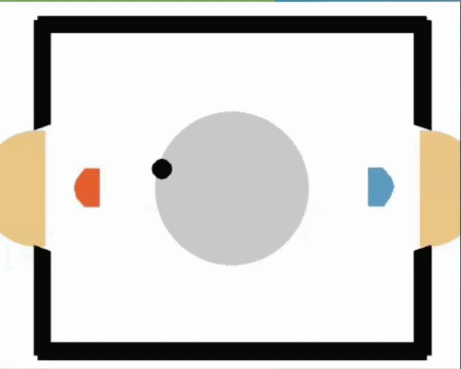
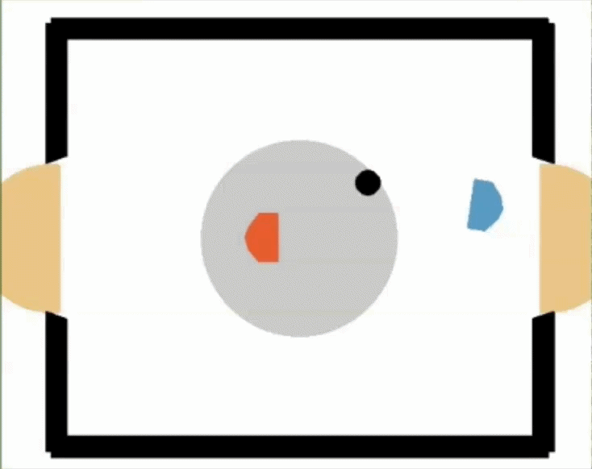
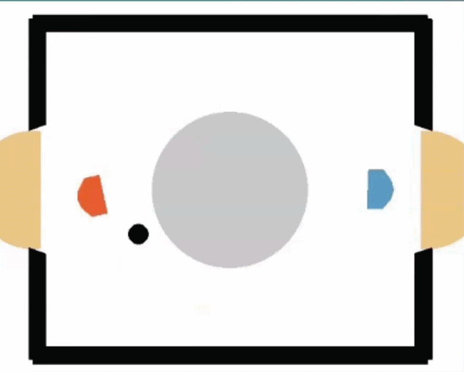
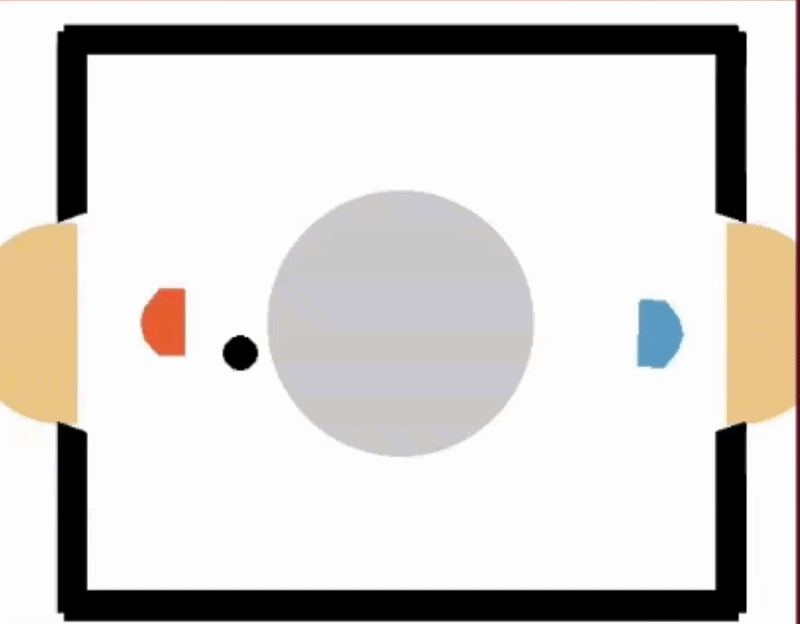
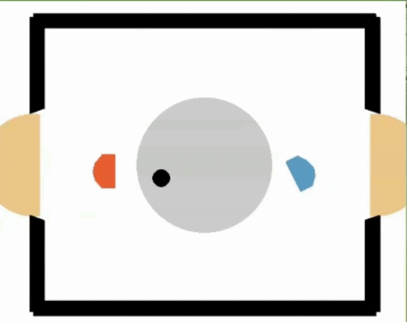
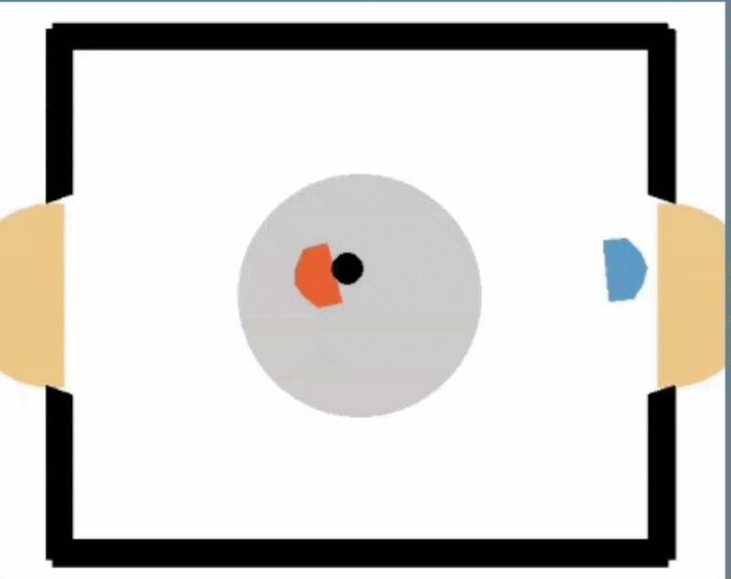
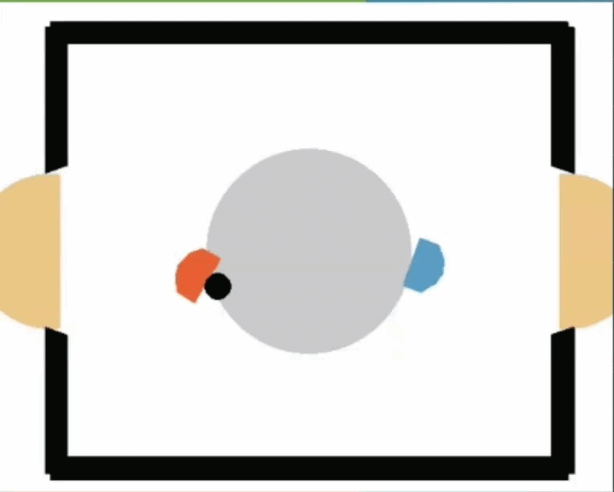

# Hockey007 - RL Agents playing in a Laser Hockey Environment

Here you can find implementations of Rainbow DQN, DDPG and TD-MPC2 for the two-player laser-hockey environment. All three run on one shared
agent interface and training loop, with single-opponent and pooled self-play training.

It is the final project of the Reinforcement Learning course, WS 2025/26, Uni Tübingen.

<!-- TODO: add hero video/gif 
<p align="center">
  
</p>-->

## Gameplay

<!-- TODO: add clips cut from the presentation -->
| Rainbow | DDPG | TD-MPC2 |
|:---:|:---:|:---:|
|  |  |  |
| Rainbow vs. weak opponent | DDPG vs. weak opponent | TD-MPC2 vs. weak opponent || Rainbow | DDPG | TD-MPC2 |

| Rainbow | DDPG | TD-MPC2 |
|:---:|:---:|:---:|
|  |  |  |
| Rainbow vs. strong opponent | DDPG vs. strong opponent | TD-MPC2 vs. strong opponent |

## Team

Each of us implemented one algorithm as shown below:

| Who | Algorithm | Code |
|---|---|---|
| Nils Klute | Rainbow DQN | [agents/RainbowAgent.py](agents/RainbowAgent.py) |
| Frieder Wizgall | DDPG (with TD3 / Fast-TD3 upgrades) | [agents/DDPGAgent.py](agents/DDPGAgent.py) |
| Georg Tirpitz | TD-MPC2 | [agents/TDMPC2Agent.py](agents/TDMPC2Agent.py) |

## The environment

We use the [hockey-env](https://github.com/martius-lab/hockey-env) (`Hockey-One-v0`) from the Martius lab.
Two players, one puck; the goal is to score in the opponent's goal.

- **Observation:** 18 values: positions, angles and velocities of both players and the puck.
- **Action:** 4 continuous values: move x, move y, rotate, shoot. Rainbow uses a discrete action set
  ([configs/rainbow_actions.txt](configs/rainbow_actions.txt), [Wrapper.py](Wrapper.py)).
- **Reward:** +10 for a win, −10 for a loss, plus a small shaping term for staying close to the puck.
- **Opponents:** the environment ships a weak and a strong scripted opponent.

We used `Pendulum-v1` to debug the algorithms before moving to hockey.

## Repo layout

```
main.py                     CLI entry point (train / pool train / play)
Core.py                     builds envs and agents
Train.py                    training loop, evaluation, pool training
agents/
  AgentBaseclass.py         common agent interface
  RainbowAgent.py           Rainbow DQN
  DDPGAgent.py              DDPG / TD3
  TDMPC2Agent.py            TD-MPC2
  networks/, utils/         per-algorithm networks and helpers
configs/                    hyperparameters per algorithm
sweeps/                     W&B sweep configs
TDMPC2_tune.py, DDPG_tune.py  W&B tuning scripts
eval.py, plots.py           evaluation and plotting
competition-server-client/  client for the course tournament server
```

### Common agent API

Every algorithm implements the same small interface from [agents/AgentBaseclass.py](agents/AgentBaseclass.py):

```python
class Agent(ABC):
    def act(self, env, state, statistics=None): ...                       # pick an action
    def observe(self, state, action, reward, next_state, terminated): ... # store a transition
    def update(self, statistics=None): ...                                 # one training step
    def save_dict(self, save_path=""): ...
    def load_dict(self, load_path=""): ...
```

Because of this, all three agents share the same training loop, evaluation, pool training and tournament
client. To add a new algorithm, you implement these five methods and register it in `Core.py`.

## Getting started

```bash
git clone git@github.com:WizgallF/hockey007.git
cd hockey007
uv sync                      # or: pip install -e .
source .venv/bin/activate
```

Train an agent against the strong basic opponent (add `--train_against_weak` for the weak one):

```bash
python main.py --train --agent rainbow --env Hockey-One-v0      # rainbow | ddpg | tdmpc2
python main.py --train --agent ddpg --num_parallel_envs 8       # parallel environments
python main.py --train --agent rainbow --env Pendulum-v1        # quick sanity check
```

Pool training, starting from a pretrained agent:

```bash
python main.py --train_self_play --agent ddpg \
    --playagent1_path <pretrained.pth> --pop_path <pool_dir>
```

Watch a trained agent play:

```bash
python main.py --play \
    --playagent_1_type ddpg --playagent1_path <agent.pth> --playagent1_config <config.yaml> \
    --playagent_2_type strongopp            # strongopp | weakopp | rainbow | ddpg | tdmpc2 | human
```

Hyperparameters are in `configs/<algo>_config.yaml`. Each run writes its checkpoints, config and plots to
`experiments/`.

## Training modes

**Single opponent.** The agent plays against the weak or strong basic opponent. This is what `--train` does.

**Pool training.** The opponent pool holds the basic opponents and agents we saved earlier
(`.pth` + matching `.yaml` with the same name in `<pool_dir>`). We start from an agent trained against the
strong opponent. Then, in each round:

1. sample an opponent from the pool,
2. train for M episodes against it,
3. evaluate against the whole pool,
4. keep the new agent only if its average win rate went up.

In the **parallel** variant, each parallel environment gets its own sampled opponent. Because the agent
sees several opponents at once, it forgets earlier opponents less.

Set `FIXED_OPPONENTS` in the config to train against a fixed pool. Otherwise the pool grows with past
versions of the agent. `main.py --train_self_play` supports Rainbow and DDPG; TD-MPC2 uses
`python TDMPC2_tune.py --self_play --self_play_population_path <pool_dir>`.

## Methods in brief

- **Rainbow DQN:** DQN with Double-Q, Dueling networks, n-step returns and Noisy Nets, plus soft (Polyak)
  target updates. Prioritized replay and distributional Q are implemented but were switched off.
- **DDPG:** actor-critic for continuous actions. On top of that we use the TD3 upgrades (twin critics, target
  policy smoothing, delayed actor updates) and two Fast-TD3 ideas: many parallel environments and a
  distributional critic with the highest quantiles cropped.
- **TD-MPC2:** learns a latent world model (encoder, dynamics, reward, Q, policy prior) and plans actions with
  MPPI in latent space. Additions: Muon optimizer and an epistemic-uncertainty bonus in the planner for
  exploration.

Hyperparameters for DDPG and TD-MPC2 were tuned with W&B sweeps ([sweeps/](sweeps/)). Rainbow was tuned by hand.

## Results

Win rate against the basic opponents after single-opponent training (5000 evaluation games):

| Agent | vs. weak | vs. strong |
|---|---|---|
| Rainbow | 0.97 | 0.69 |
| DDPG | 0.36 | 0.63 |
| TD-MPC2 | 0.85 | 0.90 |

After pool training, DDPG reaches 0.99 against both basic opponents.

Average win rate of our final agents against a pool of 20 agents:

| Agent | Win rate |
|---|---|
| Rainbow | 0.64 |
| DDPG | 0.91 |
| TD-MPC2 | 0.45 |

DDPG generalised best across the pool. TD-MPC2 was strongest against a single fixed opponent but slow at
inference, which limited its pool training.

## Presentation and report

<!-- TODO: add presentation video and report -->
- [Presentation video](assets/presentation.mp4): a short walk through the three algorithms, with gameplay.
- [Technical report (PDF)](assets/report.pdf): methods, tuning and full results.

## Acknowledgements

- [hockey-env](https://github.com/martius-lab/hockey-env) and the RL course team at Uni Tübingen
  (Georg Martius and the tutors)
- [Weights & Biases](https://wandb.ai) for the sweeps
